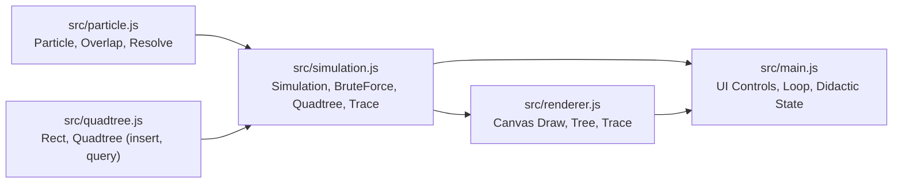
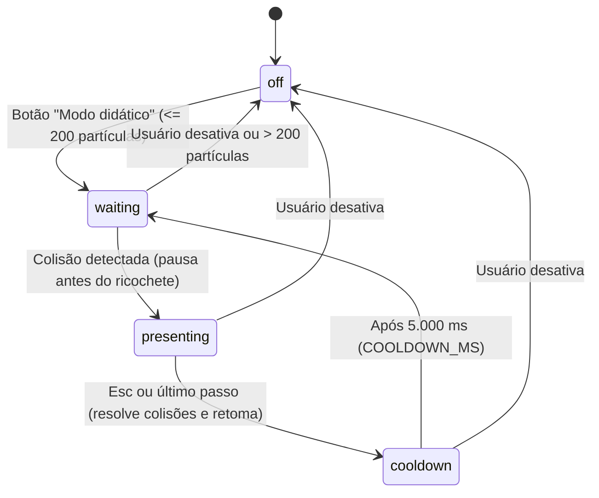

# 🏗️ Arquitetura do Sistema

O projeto segue uma arquitetura **modular plana com zero dependências externas** (Princípio V da Constituição em `.specify/memory/constitution.md`), permitindo execução direta via `index.html` no navegador (sem *bundler* ou servidor) e testes unitários nativos em Node.js (`node --test`).

---

## 🧩 Os 5 Módulos Planos (`src/`)

| Módulo | Responsabilidade Principal | Símbolos-Chave |
| :--- | :--- | :--- |
| **[`src/particle.js`](../src/particle.js)** | Física individual de partículas, quique nas bordas e resposta elástica de colisão | `Particle`, `particlesOverlap()`, `resolveCollision()` |
| **[`src/quadtree.js`](../src/quadtree.js)** | Estrutura espacial hierárquica em 4 quadrantes (`NE`, `NW`, `SE`, `SW`) com limite de profundidade | `Rect`, `Quadtree` (`capacity=4`, `maxDepth=8`) |
| **[`src/simulation.js`](../src/simulation.js)** | Orquestração de *frame*, detecção (`brute` vs. `quadtree`), *range query* e geração de *trace* didático | `Simulation`, `findPairsBruteForce()`, `findPairsQuadtree()`, `buildTrace()` |
| **[`src/renderer.js`](../src/renderer.js)** | Renderização no Canvas 2D: partículas, grade da Quadtree, região de seleção e passos do *trace* | `draw()`, `drawTree()`, `drawTrace()` |
| **[`src/main.js`](../src/main.js)** | Integração com DOM (`#canvas`, `#panel`), eventos de mouse/teclado, *loop* `requestAnimationFrame` e estado didático | `loop()`, `restart()`, `rebuildTrace()`, máquina de estados `didactic` |

---

## 🔄 Máquina de Estados do Modo Didático

Controlada em `src/main.js`, a inspeção didática pausada por colisão opera em 4 estados explícitos:

* **`off`:** Animação contínua normal (sem pausas automáticas).
* **`waiting`:** Animação rodando enquanto aguarda a próxima colisão; ao detectar, pausa antes de `resolve()` e constrói o `trace` do *frame*.
* **`presenting`:** Animação pausada exibindo iteração por iteração da detecção (`→`, `←`, `Shift + →/←`, `Enter`). Eventos de mouse no canvas são ignorados neste estado.
* **`cooldown`:** Janela de 5 segundos (`COOLDOWN_MS = 5000`) após encerrar uma apresentação, permitindo observar o ricochete antes de armar a próxima pausa.

---

## 📊 Insights do Mapeamento Estrutural (`/graphify`)

A análise estática e semântica executada com `/graphify` identificou:
* **294 nós** e **417 arestas** distribuídos em **25 comunidades** (sem ciclos de importação).
* **God Nodes centrais do domínio:** `Simulation` (11 arestas), `Quadtree` (9 arestas), `steps` (9 arestas) e `Quadtree Constitution (v1.0.0)` (19 arestas).
* **Separação estrita UI vs. Lógica Pura:** Toda a lógica em `particle.js`, `quadtree.js` e `simulation.js` é testável de forma isolada em Node.js (`tests/`), sem qualquer acoplamento ao DOM ou Canvas.
